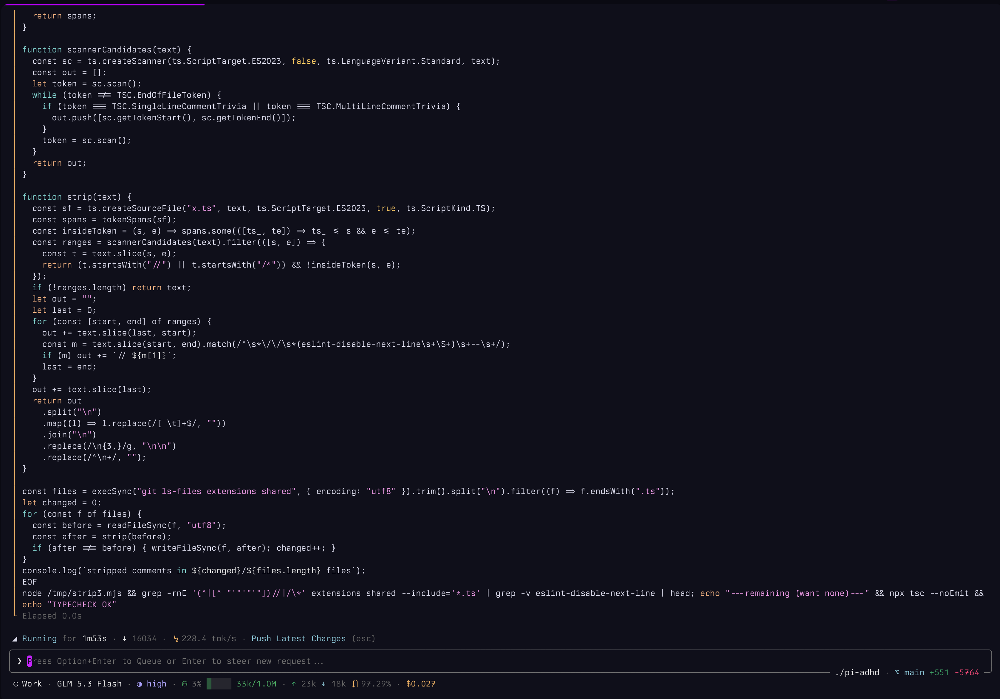

# pi-adhd

**ADHD = attention deficit hyperactivity disorder.** `pi-adhd` packages [pi](https://pi.dev) extensions that shape the agent's output for an ADHD reader: the next action first, numbered steps, visible progress, no preamble, no closer.

## Install

```bash
pi install git:github.com/CouraLabs/pi-adhd
```

Other sources:

```bash
pi install /path/to/pi-adhd        # local checkout
pi -e /path/to/pi-adhd             # try without installing
```

Then start `pi`. **Work mode** (the ADHD output contract) is the default.

## 60-second start

1. Run `pi install npm:@couralabs/pi-adhd`.
2. Run `pi`.
3. Confirm the footer starts with `⦵ Work`.
4. Type a request; the first line of the reply is the action.
5. Run `/mode pi` to hear pi's default voice, then `/mode work` to switch back.

About 2 minutes.



## What you get

Fifteen extensions, grouped by job. Toggle any of them with `/couralabs:toggle`, which opens a list where Enter flips the highlighted extension; the same list carries the feature toggles (settings-backed options such as Loading Phrases).

| Job | Extension | What it adds |
|---|---|---|
| Shape the reply | `modes` | `/mode`: cycles modes alphabetically, `/mode <name>` picks one; swaps the system prompt, footer label, and editor border |
| Shape the reply | `submodes` | `/plan` `/grill` `/straight`: read-only or guided working modes layered on top of the main mode |
| Run your workflows | `commands` | `/cmd:<name>`: saved prompts from `.agents/commands` and `.claude/commands` |
| See progress | `footer` | One-line themed status bar: countdowns, mode, model, thinking, context, usage, cost |
| See progress | `thinking` | Compact animated reasoning preview |
| Drive the loop | `spawn` | In-process subagents that run foreground and return inline |
| Run in background | `job` | `job` / `job-kill` / `job-read` / `job-list`: background shell commands kept in memory |
| Pace yourself | `timer` | `/timer 25m`: multiple named countdowns, shown live in the footer |
| Pace yourself | `pomodoro` | `/pomodoro`: work/break sessions on the same timer registry |
| Ask, don't guess | `ask-user` | `ask` tool: tabbed multi-question dialog |
| Input & output | `editor` | Closed prompt box with `❯` marker and cwd + git location |
| Input & output | `messages` | Left status rule on tool calls |
| Reach the web | `web` | `webfetch` / `websearch`: provider-neutral fetch and search |
| Use Claude | `claude` | `claude/*` models backed by the Claude Agent SDK, with a forced Claude mode and pi-rendered SDK tools |
| Name sessions | `session-title` | Names each session from its last user prompt; `/couralabs:session-title` picks the model |

## Quick reference: every command

| Command | Does |
|---|---|
| `/mode [name]` | Switch the system prompt and agent voice; bare `/mode` cycles alphabetically |
| `/submode [plan\|grill\|straight\|none]` | Enter or leave a submode |
| `/plan` `/grill` `/straight` | Toggle one submode |
| `/couralabs:toggle [name]` | Open a list to toggle extensions and feature toggles, or flip one by name |
| `/couralabs:session-title` | Show session-title state and pick the model that names sessions |
| `/couralabs:claude-limit-handoff` | Pick the model that takes over when the Claude rate limit is reached (none: wait for the reset, then auto-continue) |
| `/full-cwd [on\|off]` | Show the full working directory or only its last folder |
| `/spawn:settings` `/spawn:sessions` `/spawn:model` | Tune limits, open a transcript, set agent defaults |
| `/web` | Pick web fetch and search providers |
| `/job <name> <command...>` | Start a background job |
| `/job-kill <jobId>` | Stop a job and forget it |
| `/job-read <jobId> [lines]` | Read a job's latest output |
| `/job-list` | List jobs held in memory |
| `/timer <duration> [name]` | Start a countdown; `/timer list`, `stop`, `clear` manage them |
| `/pomodoro [stop]` | Configure and start a pomodoro session, or stop it |
| `/cmd:<name> [args]` | Send a saved prompt from `.agents/commands` or `.claude/commands` as the user message |

---

## The output contract: `modes`

One built-in mode plus any number of user modes, all switched with `/mode`:

- **⦵ Work** (default) replaces pi's default system prompt with the pi-adhd [Work rules](extensions/agent/modes/prompts/work.md). The rules are the ADHD contract: lead with the next action, number multi-step tasks, restate state every turn, cap lists, no preamble or closers. Work mode also makes the agent an orchestrator — delegate to `spawn` to keep the parent context small, use `ask` before inferring anything unknown.
- **π Pi** leaves pi's default system prompt (or a user `SYSTEM.md`) untouched.
- **◈ Any user mode** — every `<name>.md` in `~/.pi/couralabs/prompts/modes/` is a mode that replaces pi's default system prompt with the file's content. Bare `/mode` cycles through all of them (pi included) in alphabetical order; `/mode <name>` switches directly and an unknown name reports the available ones.

The replacement uses pi's `customPrompt` slot, the same mechanism as `SYSTEM.md`, so tool declarations still reach the model while the default preamble is swapped. The active mode shows first in the footer (`π Pi` in the accent color, `⦵ Work` in the default foreground), the prompt field recolors its border (accent for Pi, default border for Work), and the choice is recorded in the session and restored when that session is resumed. Modes are session-scoped: two pi instances (or two sessions in one process) each carry their own mode, and switching in one never changes another.

The full Work prompt also covers orchestration: delegate to spawned agents and ask before inferring.

## Working modes: `submodes`

Three temporary submodes layered on top of the main mode. Unlike `modes`, which *replaces* the system prompt, a submode **appends** named prompt sections and sets the active tools to the submode's whitelist. Plan and Grill are read-only plus the spawn tools; **Straight keeps the full toolset**, because it is the only submode that may change code.

1. Enter with `/submode plan`, `/submode grill`, or `/submode straight` (or toggle with `/plan`, `/grill`, `/straight`).
2. Read the active submode in the footer next to the mode (`⦵ Work ∙ ⧉Plan`). Like the mode, it is recorded in the session and restored when that session is resumed, never shared with another pi instance.
3. Leave or switch with the `submode-exit` tool (`mode: "exit" | "plan" | "grill" | "straight"`); the current run ends so the target prompt and tools take effect next turn.

The mode prompt and the submode prompt never bleed into each other. The mode replaces pi's preamble through the `customPrompt` slot, and the submode appends its own named section, so the effective system prompt is **Mode Prompt + Submode Prompt** with pi's cwd/context/skills sections still appended. Pi rebuilds the option object from its own base on every run, so a mode swap never leaves a stale submode section behind and a submode never rewrites the mode prompt.

Two sections are appended, in this order:

1. `<plan_mode>` / `<grill_mode>` / `<straight_mode>` — opens with an `ACTIVE SUBMODE: <name>` directive naming the submode and its role, then the prompt from `extensions/agent/submodes/prompts/`.
2. `<submode_policy>` — generated on every run. It lists the exact tools the model may call and names every registered tool that does not exist in this submode. The policy is appended last, so it is the final text of the system prompt.

The whitelist is per submode, and `ask` is dropped in hosts without a UI, where `ask-user` withdraws it:

| Submode | Tools |
| --- | --- |
| ⧉Plan | `read`, `grep`, `find`, `ls`, `ask`, `plan-write`, `submode-exit`, `spawn` |
| 𐂐 Grill | `read`, `grep`, `find`, `ls`, `ask`, `submode-exit`, `spawn` |
| ⛬ Straight | `read`, `bash`, `edit`, `write`, `grep`, `find`, `ls`, `ask`, `spawn`, `submode-exit` |

- **⧉Plan** ([plan.md](extensions/agent/submodes/prompts/plan.md)) — the architect. Studies the codebase and submits a concrete, ordered implementation plan for review. It never edits files.
- **𐂐 Grill** ([grill.md](extensions/agent/submodes/prompts/grill.md)) — the designer. Interviews you in rounds across a design tree until you share an understanding, then hands off to Plan (or straight to the coder).
- **⛬ Straight** ([straight.md](extensions/agent/submodes/prompts/straight.md)) — the guided feature-development submode. It asks clarifying questions, explores the codebase, proposes designs, then implements the approved one with the full toolset. It is the only submode that can change code.

### Plan review

While the Plan agent writes the plan, the `plan-write` call streams the plan text inline — a compact tail of up to 10 lines (all when expanded), like the thinking preview — before the full plan opens for review.

`plan-write` blocks the run and opens a fullscreen, line-numbered review pane (a focused overlay in fullscreen TUI mode, docked in regular mode):

```
── Plan review ───────────────────── 42 lines · 1 comment ──
❯ 12  ## Task 2: Wire the queue
  13  - add `src/queue.ts`
  14  - call `enqueue()` from the handler
  15    💬 cover the backpressure case here
  ...
── ↑↓ scroll · c comment · d delete · 1 approve · 2 approve+compact · 3 reject · Esc cancel ──
```

Press `c` on any line to attach a comment, `d` to delete it, and one of three verdicts:

| Key | Verdict | Effect |
|---|---|---|
| `1` / `a` | Approve | Exit the submode; the stored plan is queued as the next prompt and the coder implements it |
| `2` | Approve and Compact | Compact the session, then send the plan as the next prompt |
| `3` / `r` / `Esc` | Reject | Stop the run and wait for you; the line comments are returned to the model |

A rejection's line comments come back as `line N: <comment>` so the model can revise precisely and resubmit. The plan is held in memory for the run, so the Approve and Compact flow can resend it after the session is compacted.

### Plan reviewer agent

The built-in `plan-reviewer` agent is a practical, read-only blocker-finder (`read`, `grep`, `find`, `ls`) that verifies referenced files exist and returns `[OKAY]` or a max-3 `[REJECT]`. It ships as an embedded default, so it is available wherever pi-adhd is installed. The Plan agent spawns it with the `spawn` tool before calling `plan-write` (see [plan.md](extensions/agent/submodes/prompts/plan.md)).

## Prompt commands: `commands`

Project prompt libraries become pi commands. `commands` scans `.agents/commands/` and `.claude/commands/` for markdown files and registers each as `/cmd:<file-name>` (`promote.md` → `/cmd:promote`; nested folders namespace with colons: `review/plan.md` → `/cmd:review:plan`), shown in the command list with the file's frontmatter `description`.

```
.agents/commands/promote.md
---
description: "Create the GitHub release, announce the version on Discord..."
---

Publish a new pi-adhd version.

1. Run `git status --short` and tell me if there are uncommitted changes...
```

Running `/cmd:promote` sends the body (frontmatter stripped) to the conversation as your message, and the agent works from it like any other prompt. `$ARGUMENTS` in the body is replaced with whatever is typed after the command (`/cmd:release 2.1.0`), and with no placeholder the typed text is appended to the prompt. Other frontmatter keys (`model`, `allowed-tools`) are ignored. Files are read at load time, so adding or editing one takes effect on the next `/reload`. `.agents/commands` is scanned first, so a name in both folders resolves to the `.agents` copy.

## Prompt field: `editor`

Wraps the prompt editor in a closed field drawn with terminal box characters (`╭ ╮ ╰ ╯ │ ─`), inset by a one-column margin on each side, with a `❯` marker on the first input line; the working directory and git state are embedded in the bottom border, and the box recolors with the agent mode. The spinner animation (`🞗` → `🞘` → `🞙` → `🞚` → `🞛` → `🞜` → `🞛` → `🞚` → `🞙` → `🞘`, 100ms) no longer sits in the border, and pi's built-in working row is hidden: while the agent runs, a loading widget floats above the field as a persistent widget slot,

```
🞘 Reading for 12s ∙ ↓ 3400 ∙ ⭍ 214.2 tok/s ∙ Fix login redirect (esc)

 ╭──────────────────────────────────────────────────────╮
 │ ❯ explain this codebase                              │
 ╰──────── pi-adhd ∙ ⌥ main +12 -3 ─────────────────╯
```

naming what is executing — `Prompting` on the round-trip before the first streamed token, `Thinking` while reasoning streams, `Answering` while reply text streams, and the executing tool's verb between them (`Reading`, `Writing`, `Editing`, `Running` for the shell; any unmapped tool shows the fallback `Tooling`). Each phase rides its own semantic color: `warning` while waiting on the model, `accent` while a tool executes, `success` while output streams. The verb map is configurable in `editor.toolVerbs` (e.g. `{"grep": "Grepping", "webfetch": "Fetching"}`); it is followed by the run clock (`for 12s`, `for 1m32s`, …), the raw output-token estimate (`↓ 3400` — streamed characters ÷ 4, updated on every delta), and the live rate (`⭍ 214.2 tok/s` — estimate ÷ streaming time only: each LLM return's span starts at its first token, so the request round trip, the first-token wait, and the tool gaps between returns never dilute it), plus the `esc`-interrupt hint.

When the run settles, the widget does not vanish with pi's working row: it keeps the last turn's clock and output tokens on screen while the next prompt is typed —

```
✓ Finished in 45s ∙ ↓ 12300 ∙ ⭍ 275.4 tok/s ∙ Fix login redirect
```

— until the next run overwrites the summary. The empty prompt field shows a status-adaptive placeholder — `What are we going to build today?` while idle, `Press Alt+Enter to Queue or Enter to steer new request...` (the live queue keybinding) while the agent runs. Toggle the whole prompt field with `/couralabs:toggle editor`.

The box border color follows the active agent mode (see [`modes`](#the-output-contract-modes)): the theme's `border` token in Work, the `accent` token in Pi, and the `borderAccent` token in user modes, instead of tracking the thinking level. The bottom-border location segment shows the working directory followed by the git branch and the added/removed line counts from `git diff --numstat` (`+n` in success green, `-n` in error red). By default only the last folder of the working directory is shown; `/full-cwd` toggles the full path on and off (`/full-cwd on` / `/full-cwd off`), keeping the home directory itself rendered as `~` either way. Toggle the whole prompt field with `/couralabs:toggle editor`.

## Status bar: `footer`

Replaces the built-in footer with a compact, theme-aware status bar. Toggle it with `/couralabs:toggle footer`.

```
  ⏱ 1h20m30s ∙ 🍅 Work 1/4 12m30s ∙ ⦵ Work ∙ ⧉Plan ∙ anthropic/claude-sonnet-4 ∙ ▶▶ high ∙ ⛁ ███▒░ 124k/200k (62%) ∙ ↑ 120k ∙ ↓ 8.4k ∙ ⮏ 87% ∙ $0.842
```

The stats line leads with any running countdowns: the plain timer that expires first (`⏱ 1h20m30s`) and the current pomodoro phase (`🍅 Work 1/4 12m30s`, or `☕ Break 4m`), each ticking down live. They are drawn before the active agent mode (see [`modes`](#the-output-contract-modes)) and, when one is active, the submode (see [`submodes`](#working-modes-submodes)), which precede the current provider/model, thinking level (colored along pi's thinking-level gradient), the context-window gauge, and cumulative input/output/cache/price usage. Statuses published by other extensions via `ctx.ui.setStatus()` render on a separate line below. Extensions can also register a section that the footer draws last, below the statuses. Everything adapts to the active theme and degrades gracefully on narrow terminals.

## Tool calls: `messages`

Restyles tool calls to share the pi-adhd look. Each call renders as a tree hanging from a status-colored pick glyph (`⛏`): the tool name is rewritten to PascalCase in the renderer's own style (a shell renderer's `$`/`PS>` prompt stands in for the name and is rewritten too), and a dim rule runs below the glyph down every content row, so the call header and its result body hang from the same stem. Blank pad rows at either edge of a block — box renderers' padding, a shell result's leading spacer, a newline before a timer line — are trimmed or collapsed, so the rule runs unbroken from the glyph to the last visible row. The bash command is syntax-highlighted in the header, and `edit` diffs are syntax-highlighted per line in the edited file's language (the sign-and-line-number gutter keeps the renderer's add/remove/context colors). Toggle it with `/couralabs:toggle messages`.

```
⛏ Read src/index.ts
│ ...

⛏ Bash npm test
│ ... (5 earlier lines, ctrl+o to expand)
│ Took 1.2s
```
The glyph follows the tool's lifecycle in the theme's semantic colors — `warning` while the call is mere paperwork (arguments still arriving), `accent` (the theme's info blue) while it runs, then `error` or `success` once the result settles. Where a header leads with something else entirely — a classification tag — only the icon is added. Toggling affects tool calls rendered after the change; already rendered rows keep their current look until the transcript is rebuilt (for example by resuming or reloading the session).

## Clarifying questions: `ask-user`

Adds the `ask` tool: the model can surface clarifying questions with selectable options. Multi-question calls render as a tabbed dialog with a Submit review page; each option can carry a markdown/code preview, single-select uses radio markers and `multi` uses checkboxes, and an inline `Other` field provides free-form input. An inactivity countdown (`timeoutSeconds`) auto-picks the recommended option, and cancelling aborts the turn. Print/JSON hosts cannot prompt, so the tool is stripped from the active set there. Answers persist in the tool result `details`.

## Reasoning preview: `thinking`

A vendored, pi-adhd-adapted port of [`pi-compact-thinking`](https://github.com/nostalfinals/pi-compact-thinking): replaces the built-in **hidden** thinking renderer with a compact, animated run. Each run shows an animated heading — the latest OpenAI reasoning-summary title when available, otherwise `Thinking...` — the elapsed time, and a few preview lines. When the body is truncated, the heading gains a `(N more lines, key to expand)` hint:

```
Reviewing the failing test · 4s (12 more lines, shift+tab to expand)
  the assertion expects the handler to be registered before the session starts
  so the ordering must move earlier in the bootstrap
```

When the run finishes the heading settles on `Thought for 4s`. Visible thinking is left exactly as pi renders it, so the thinking-visibility toggle still expands the full reasoning block. Durations render as `ms`, `s`, `m`, or `m Ns`.

Compact mode activates when pi hides thinking (`hideThinkingBlock: true` in pi's settings, and `Shift+Tab` toggles it). The extension patches pi's internal assistant-message renderer — pi exposes no hook for the hidden-thinking body — so it may need updating after a pi upgrade. Toggle the extension with `/couralabs:toggle thinking`.

## Subagents: `spawn`

In-process autonomous spawned agents, vendored from [`@gotgenes/pi-subagents`](https://github.com/gotgenes/pi-packages/tree/main/packages/pi-subagents) (MIT) and restructured to the pi-adhd layout. Agents run inside the same pi runtime — no subprocesses — each in an isolated child session with its own tools, system prompt, model, and thinking level.

The model spawns agents with the `spawn` tool (`spawn_type`, `prompt`, `description`, and optional `model`, `thinking`, `max_turns`, `resume`, `inherit_context`). Every agent runs foreground: the call blocks until the agent finishes and its result comes back inline, so several independent pieces of work are launched in one turn and their results are synthesized as they arrive. `/spawn:settings` tunes turn limits and session retention; `/spawn:sessions` opens a running or completed agent's transcript in pi's read-only viewer.

`/spawn:model` sets a spawned agent's defaults: it lists every agent type — the built-ins `general-purpose`, `plan-reviewer`, `Arquitect`, `Code-Review`, and `Explore` plus the `.agents/agents/*.md` files from the project and `~/.agents/agents/` — annotated with each agent's current model and thinking level, then offers both for the chosen agent. Choosing a model persists it and goes straight to the thinking-level picker, which offers only the levels the chosen model supports (from its `reasoning` flag and `thinkingLevelMap` — a non-reasoning model offers only `off`); esc there keeps the model and leaves thinking untouched. The standalone "Thinking:" action filters the same way, by the agent's already-set model (when that model resolves among the available ones). The dialog loops: after a pick, the agent list returns with the new value shown, so the write is visible without reopening the command; esc exits. Each picker also offers "Inherit (clear override)" to drop an override. A built-in choice is stored in `~/.pi/couralabs/settings.json` under `spawn.agentModels` / `spawn.agentThinking`; a custom agent's choice is written as a `model:` / `thinking:` key in its own markdown frontmatter.

Agent types are defined in `.agents/agents/<name>.md` (project) and `~/.agents/agents/<name>.md` (global) with YAML frontmatter for the prompt, model, thinking level, tools, and `max_turns`. The built-in `general-purpose`, `plan-reviewer`, `Arquitect`, `Code-Review`, and `Explore` types cover the common cases. Lifecycle events (`spawn:started`, `completed`, `failed`, `resuming`, `resumed`, `compacted`, `settings_loaded`, `settings_changed`) are emitted on `pi.events`, and a typed `SpawnService` is published for other extensions.

Disable the whole extension with `/couralabs:toggle spawn`; an already-running agent keeps running until it settles, and `/spawn:settings` and `/spawn:sessions` are unavailable in a spawned child session.

## Web access: `web`

Two tools:

- `webfetch({ url, format?, max_characters? })` — fetch a URL as plain text (`format` selects the upstream format; the tool always returns plain text; `max_characters` truncates, default 1000, `0` = unlimited).
- `websearch({ query, search_type?, max_results? })` — search the web (`search_type` is `web` or `news`; `max_results` defaults to 5, max 10).

With the default `auto` provider, each call tries every configured provider in registration order and returns the first success, reporting which provider won and how many others failed. Every request is capped at 30 seconds.

| Service | Providers |
| --- | --- |
| Fetch | `curl` (no key needed — plain HTTPS + HTML-to-text), `jina-reader`, `exa`, `tavily`, `firecrawl`, `ollama`, `youcom`, `9router` |
| Search | `searxng` (no key needed, self-hosted), `exa`, `tavily`, `perplexity`, `serper`, `brave-search`, `youcom`, `google-pse`, `searchapi`, `linkup`, `xquik`, `ollama-search`, `glm`, `9router` |

Each provider names its env vars: `EXA_API_KEY`, `TAVILY_API_KEY`, `FIRECRAWL_API_KEY`, `JINA_API_KEY`, `OLLAMA_API_KEY` / `OLLAMA_URL`, `YDC_API_KEY`, `NINEROUTER_KEY` / `NINEROUTER_URL`, `SEARXNG_URL`, `PERPLEXITY_API_KEY`, `SERPER_API_KEY`, `BRAVE_API_KEY`, `GOOGLE_PSE_API_KEY` / `GOOGLE_PSE_CX`, `SEARCHAPI_API_KEY`, `LINKUP_API_KEY`, `XQUIK_API_KEY`, `ZAI_API_KEY`. With no keys set, `webfetch` still works through `curl`.

`/web` walks both services: pick the provider from a list that marks unconfigured ones with the env vars they need.

## Background jobs: `job`

Four tools that run shell commands in the background and keep their output in memory, so the agent can start a dev server, a watch, or a long test and keep working while it runs:

- `job({ name, command, timeout? })` — start a command and return its `jobId` immediately. `timeout` is in seconds; the job is killed when it elapses.
- `job-read({ jobId, lines? })` — the last `lines` captured lines (default 50, max 500) and the job's current status.
- `job-kill({ jobId })` — stop the job, close its process tree, and forget it.
- `job-list({})` — every job held in memory, running and finished, with its status and latest line.

```
job({ name: "dev", command: "npm run dev" })
  → job-1 "dev"
job-read({ jobId: "job-1", lines: 20 })
  → job-1 "dev" · running
    VITE ready in 312 ms
    ➜  Local: http://localhost:5173/
```

The registry is process memory only — nothing is persisted and nothing survives a reload. On `session_shutdown` every running job is killed, so a reload or session replacement never leaks a process. Captured output is bounded (2000 lines per job, 100 jobs) and `job-read` returns only the tail. Spawned child sessions exclude the job tools, so a child cannot own a second, invisible registry or leave a process behind.

The same actions are available as commands, with the name first and the command after it:

```
/job dev npm run dev
/job --timeout 300 build npm run build
/job-list
/job-read job-1 50
/job-kill job-1
```

## Timers: `timer`

`/timer <duration> [name]` starts a countdown. Several can run at once, and the footer shows the one that expires first, ticking down live. Durations combine `h`, `m`, and `s`, and the optional name is a quoted or bare label:

```
/timer 90s
/timer 5m
/timer 1h
/timer 25m30s
/timer 10s "Take a break"
/timer 10s Take a break
```

The pattern must consume the whole argument, so `1h30` is rejected rather than guessed. When a timer elapses it rings the terminal bell, shows an in-app notification, and pushes a native OS notification (titled `Pi ADHD`, reading `Timer <name> finished.`, where an unnamed timer uses its duration). Three more forms manage the set:

```
/timer list            ⏱ 4m10s — alpha (timer-…-1)
                       ⏱ 18m00s — Take a break (timer-…-2)
/timer stop alpha      cancel one by name or id
/timer clear           cancel every timer
```

Timers are session-scoped: they are created by the command and cancelled on `session_shutdown`. The bell is written to the terminal only when stdout is a TTY, so print and RPC modes are never corrupted by a stray control byte. The OS notification uses the platform's own notifier — `osascript` on macOS, `notify-send` on Linux, a PowerShell balloon tip on Windows — spawned detached so it never blocks or keeps pi alive, and skipped silently when the notifier is not installed. Set `timer.osNotification` to `false` to turn it off.

## Pomodoro: `pomodoro`

`/pomodoro` opens a config dialog — work, short break, long break, and rounds — then starts the first work phase:

```
── Pomodoro ────────────────────── 25m work · 5m break · 4 rounds ──
→ Work        25m
  Break       5m
  Long break  15m
  Rounds      4
  Start       ▶

  Length of one focus session.

  Enter/Space to change · Esc to cancel
```

Each row cycles through presets with Enter/Space; the last row starts the session, and Esc cancels without saving. The chosen values are persisted under the `pomodoro` settings key, so the next dialog opens on the last-used configuration. On hosts without the TUI (RPC, print) the command starts straight away with the saved configuration.

Every phase is a normal countdown in the same registry as `/timer`, so the footer shows it exactly the same way (`🍅 Work 1/4 12m30s`, `☕ Break 4m`). When a work phase ends the next break is scheduled automatically — a short break between rounds and a long break after the last one — and the session ends when the long break completes. Each boundary rings the bell and pushes an OS notification (`Work 1/4 finished — break time.`). `/pomodoro stop` cancels early; the pending phase is also cancelled on `session_shutdown`. The pomodoro shares the `timer.osNotification` switch.

## Claude provider: `claude`

Registers a `claude` provider with `claude-opus-5-5`, `claude-sonnet-5-5`, and `claude-haiku-5-5` (200k context), plus a 1M-context variant of each with a `[1m]` suffix (e.g. `claude-sonnet-5-5[1m]`, listed as "Claude Sonnet 5.5 (1M)"). Pick one with `/model`. Subagent aliases (`sonnet`, `opus`, `haiku`) use the 200k models. The Claude Agent SDK runs the agent loop, system prompt, and tools; pi renders every tool call and keeps the transcript, so you can switch to a non-Claude model at any time.

- **Claude mode.** Selecting a `claude/*` model forces the Claude mode and disables `/mode pi` and `/mode work`. Plan, Grill, and Straight submodes keep working, with tool names mapped to the SDK's (`read` is `Read`, `find` is `Glob`, and so on). Switching to another model restores the previous mode and pi's tools.
- **Tool ownership.** SDK built-ins (`Read`, `Write`, `Edit`, `Bash`, `Grep`, `Glob`, `WebFetch`, `WebSearch`, `Agent`, `AskUserQuestion`, `TaskStop`, `Skill`) run in the SDK and show up as mirror tools in pi's renderers. `codemode`, `plan-write`, and `submode-exit` run in pi and are reached by the SDK as `mcp__pi__*`. `AskUserQuestion` uses the `ask` dialog.
- **Redirected commands.** `/compact`, `/new`, `/model`, `/job*`, and `/spawn:*` act on the SDK session while a Claude model is active. SDK slash commands appear as pass-through pi commands.
- **Background tasks report back.** SDK background tasks (Bash with `run_in_background`, backgrounded subagents) surface their completion as a transcript entry the moment the SDK emits the finish event — the task notice (exit status, summary) plus the model's own report — instead of sitting silently until the next prompt. `/job-list` stays live the whole time through the SDK's task-level updates.
- **Subagents.** `.agents/agents/*.md` become SDK agent definitions.
- **MCP servers can appear twice.** The SDK loads your `~/.claude` settings, CLAUDE.md, hooks, and MCP servers, while pi's MCP servers are reachable through `codemode`. The same server may be available both ways; this is allowed.

**Authentication.** pi-adhd never handles Claude credentials: no `/login` entry, no reading of `~/.claude`, nothing written to `auth.json`. The bundled `claude` binary uses your own `ANTHROPIC_API_KEY` or your own `claude /login` session.

**Publishing.** Personal use on your own plan is ordinary, individual usage. If you build a product on top of this for other people, Anthropic's terms for the Agent SDK point developers to API key authentication, so use an API key in that case. This is not legal advice; check Anthropic's current terms. Do not call the feature "Claude Code" or use Anthropic logos.

## Session names: `session-title`

When a run settles in a session that has no name yet, the extension asks a model for a short title generated from that run's user prompt and sets it as the session's display name — the name the session selector shows. A session is named once: a user-set name is never overwritten. Spawned child sessions are skipped. Every failure path falls back to the prompt's first line, so a naming failure never surfaces as an error.

- **Model.** `/couralabs:session-title` reports the feature's state — enabled or disabled, and the model in force — then opens a picker over every auth-configured model. Picking a model stores it under `sessionTitle.model` (as `provider/id`) and enables the feature; "Session model (no override)" clears the override so the session's current model writes titles. Disabling is `/couralabs:toggle session-title`.
- **Fallback.** With no override, the session's current model writes the title.
- **Concurrency.** Runs are keyed per session, and a new run aborts a still-pending naming call, so a session is never named from a stale prompt.

## Configuration

Every pi-adhd setting lives in a single JSON file:

```
~/.pi/couralabs/settings.json
```

It is organized as `{ feature: { option: value } }`, plus a top-level `extensions` array naming which extensions the barrel loads, and is created with the defaults the first time pi-adhd loads, so it always contains the complete set of knobs:

```json
{
  "extensions": [
    "editor",
    "footer",
    "messages",
    "thinking",
    "modes",
    "submodes",
    "commands",
    "ask-user",
    "job",
    "pomodoro",
    "spawn",
    "timer",
    "web",
    "claude",
    "session-title"
  ],
  "editor": { "fullCwd": false, "toolVerbs": { "grep": "Grepping" } },
  "thinking": {
    "useSummaryTitlesAsThinkingTitle": true,
    "previewLines": 5,
    "animationIntervalMs": 90
  },
  "spawn": {
    "defaultMaxTurns": 0,
    "wrapUpTurns": 2,
    "consumedSessionRetentionMinutes": 10,
    "unconsumedSessionRetentionMinutes": 720,
    "excludedExtensionPackages": [],
    "promptInheritance": {},
    "agentModels": {}
  },
  "timer": { "osNotification": true },
  "pomodoro": { "workMinutes": 25, "breakMinutes": 5, "longBreakMinutes": 15, "rounds": 4 },
  "sessionTitle": { "enabled": true, "model": "anthropic/claude-haiku-5-5" },
  "web": {
    "fetch": { "provider": "auto", "nineRouterModel": "exa" },
    "search": { "provider": "auto", "nineRouterModel": "exa" }
  }
}
```

| Feature | Option | Default | Description |
|---|---|---|---|
| `extensions` | — | every extension | Extensions the barrel loads; anything absent is not loaded (edit with `/couralabs:toggle`) |
| `editor` | `fullCwd` | `false` | Show the full working directory instead of only its last folder (toggle with `/full-cwd`) |
| `editor` | `toolVerbs` | built-in map¹ | Tool name → gerund for the working status while it executes; unmapped tools show `Tooling` |
| `thinking` | `useSummaryTitlesAsThinkingTitle` | `true` | Use the latest OpenAI reasoning-summary heading as the live title |
| `thinking` | `previewLines` | `5` | Reasoning-preview lines retained; `0` hides the preview |
| `thinking` | `animationIntervalMs` | `90` | Milliseconds between animation frames while reasoning |
| `spawn` | `defaultMaxTurns` | `0` | Default turn ceiling; `0` = unlimited |
| `spawn` | `wrapUpTurns` | `2` | Turns left when an agent is warned to wrap up |
| `spawn` | `consumedSessionRetentionMinutes` | `10` | Minutes a consumed agent's session is retained |
| `spawn` | `unconsumedSessionRetentionMinutes` | `720` | Minutes an unconsumed agent's session is retained |
| `spawn` | `excludedExtensionPackages` | `[]` | Pi package sources whose extensions child sessions must not load |
| `spawn` | `promptInheritance` | `{}` | Per-provider prompt strategy (`full` or `portable`) |
| `spawn` | `agentModels` | `{}` | Per-built-in-agent model override, set by `/spawn:model` |
| `spawn` | `agentThinking` | `{}` | Per-built-in-agent thinking override, set by `/spawn:model` |
| `timer` | `osNotification` | `true` | Push a native OS notification when a timer or pomodoro phase fires, in addition to the bell |
| `pomodoro` | `workMinutes` | `25` | Length of a work session |
| `pomodoro` | `breakMinutes` | `5` | Length of a short break |
| `pomodoro` | `longBreakMinutes` | `15` | Length of the long break after the last round |
| `pomodoro` | `rounds` | `4` | Work sessions before the long break |
| `web` | `fetch.provider` | `"auto"` | Default web fetch provider; `auto` tries every configured one in order |
| `web` | `fetch.nineRouterModel` | `"exa"` | Model the 9Router aggregator fetches with |
| `web` | `search.provider` | `"auto"` | Default web search provider; `auto` tries every configured one in order |
| `web` | `search.nineRouterModel` | `"exa"` | Model the 9Router aggregator searches with |
| `sessionTitle` | `enabled` | `true` | Name each session from its last user prompt (toggle with `/couralabs:toggle session-title`) |
| `claudeLimitHandoff` | `model` | unset | Model (`provider/id`, non-Claude) that takes over when the Claude limit is hit; unset: wait for the reset and send "continue the implementation where it did stop" (set with `/couralabs:claude-limit-handoff`) |
| `sessionTitle` | `model` | unset | Model that writes the title, as `provider/id`; unset: the session's current model (set with `/couralabs:session-title`) |

The `/couralabs:toggle` command opens an interactive list of every extension with its current state, followed by the feature toggles — settings-backed options that change a loaded extension's behavior without loading or unloading anything (currently `session-title`). Move with `↑↓` (or `j`/`k`) and press Enter to flip the highlighted row; `Esc` closes. Changes are persisted as you toggle and the extension set reloads once the list closes, so the choice survives reloads and new sessions. Passing a name — `/couralabs:toggle editor` — skips the list and flips that item directly, which is also the only form available when the session has no dialog UI. Missing keys fall back to the defaults and unknown keys are preserved, so the file can be edited by hand. `/spawn:settings` edits the operational `spawn` options (numeric values open an input prompt).

```
── pi-adhd extensions ───────────────────── 11 on · 3 off ──
❯ [x] editor    pi-adhd prompt field
  [x] footer    pi-adhd footer / stats line
  [x] messages  pi-adhd tool-call message UI
  [ ] job       background terminal jobs
  [ ] pomodoro  pomodoro work/break sessions
  [ ] timer     /timer bell countdown
  [x] web       web fetch and search tools
── ↑↓ move · Enter toggle · Esc close ──────────────────────
```

## Themes

Fourteen themes ship with the package. Select one with `/settings` → **Theme**, or for one run:

```bash
pi --use-theme synthwave84
```

| Theme | Appearance |
|---|---|
| `synthwave84` | Dark — neon '80s palette |
| `aura` | Dark — dark purple palette |
| `cursor-dark` / `cursor-light` | Cursor's dark and light palettes |
| `gruvbox-dark` / `gruvbox-light` | Gruvbox dark and light palettes |
| `matrix-dark` / `matrix-light` | Matrix rain palettes |
| `tokyo-night` | Dark — Tokyo Night Storm |
| `one-dark` | Dark — One Dark Pro |
| `catppuccin-mocha` | Dark — Catppuccin Mocha |
| `dracula` | Dark — Dracula |
| `nord` | Dark — Nord |
| `rose-pine` | Dark — Rosé Pine |

`cursor`, `gruvbox`, and `matrix` each ship as an adaptive `-dark`/`-light` pair. Pair a set in settings to follow the terminal appearance:

```json
{ "theme": "cursor-light/cursor-dark" }
```

## Where to change things

| You want to change… | Edit… |
|---|---|
| The ADHD output rules | `~/.pi/couralabs/prompts/modes/work.md` (offloaded from `extensions/agent/modes/prompts/work.md` on load) |
| A `/cmd:<name>` prompt command | `extensions/agent/commands/index.ts` (scans `.agents/commands` + `.claude/commands`) |
| A submode's prompt | `~/.pi/couralabs/prompts/submodes/<name>.md` (offloaded from `extensions/agent/submodes/prompts/<name>.md` on load) |
| A built-in sub-agent's prompt | `~/.pi/couralabs/prompts/subagents/<name>.md` (offloaded from `extensions/tools/spawn/config/default-agents.ts` on load) |
| Submode tool whitelists | `extensions/agent/submodes/index.ts` |
| Footer layout | `extensions/ui/footer/render.ts` |
| Prompt box drawing | `extensions/ui/editor/field-editor.ts` |
| Working-status tracker | `extensions/ui/editor/status.ts` |
| Background job limits and capture | `extensions/tools/job/manager.ts` |
| Timer duration syntax | `extensions/tools/timer/parse.ts` |
| Pomodoro phases and chaining | `extensions/tools/pomodoro/index.ts` |
| Timer/pomodoro registry and footer feed | `shared/timers.ts` |
| OS notification | `shared/os-notify.ts` |
| Web providers | `extensions/tools/web/providers.ts`, `search-providers.ts` |
| Title-generation prompt and fallback | `extensions/ui/session-title/generator.ts` |
| Settings schema and defaults | `shared/settings.ts` |
| Shared UI glyphs | `shared/glyphs.ts` |

## Project layout

```text
pi-adhd/
├── extensions/
│   ├── index.ts             # barrel: loads every extension below (ui → agent → tools → providers)
│   ├── ui/                  # individually loadable UI extensions
│   │   ├── editor/
│   │   │   ├── index.ts         # extension factory: git timers + event wiring
│   │   │   ├── field-editor.ts  # the boxed prompt editor component
│   │   │   ├── git.ts           # branch + `git diff --numstat` parser
│   │   │   ├── status.ts        # working-status tracker: phase, run clock, token estimate, streaming-time rate
│   │   │   ├── loading.ts       # loading widget above the editor: spinner, tokens, live tok/s
│   │   │   └── spinner.ts       # loading-widget animation frames
│   │   ├── footer/
│   │   │   ├── index.ts         # extension factory: usage cache + event wiring
│   │   │   └── render.ts        # pure footer rendering
│   │   ├── messages/
│   │   │   ├── index.ts         # extension factory: renderer wiring
│   │   │   ├── renderers.ts     # status detection + color mapping + wrapping
│   │   │   └── tool-frame.ts    # inline frame: pick glyph + PascalCase name + dim rule
│   │   ├── thinking/
│   │       ├── index.ts         # extension factory: component patch + event wiring
│   │       ├── config.ts        # thinking config backed by couralabs/settings.json
│   │       ├── durations.ts     # per-run duration persistence + restore
│   │       ├── preview.ts       # reasoning-preview component + duration formatting
│   │       ├── summaries.ts     # OpenAI reasoning-summary extraction
│   │       └── types.ts
│   │   └── session-title/
│   │       ├── index.ts         # extension factory: prompt capture + naming + /couralabs:session-title
│   │       ├── command.ts       # the `/couralabs:session-title` model picker
│   │       ├── config.ts        # session-title config backed by couralabs/settings.json
│   │       └── generator.ts     # title generation + prompt-first-line fallback
│   ├── providers/
│   │   └── claude/              # Claude Agent SDK provider: bridge, mirror tools, MCP server, renderers, commands
│   ├── agent/               # individually loadable mode extensions
│   │   ├── commands/
│   │   │   └── index.ts         # extension factory: .agents/.claude prompt commands
│   │   ├── modes/
│   │   │   ├── index.ts         # extension factory: `/mode` + prompt swap
│   │   │   └── prompts/         # static .md prompt assets
│   │   └── submodes/
│   │       ├── index.ts         # extension factory: prompt sections + tool policy
│   │       ├── plan-review.ts   # fullscreen plan-review pane
│   │       ├── plan-write.ts    # the `plan-write` tool
│   │       ├── submode-exit.ts  # the `submode-exit` tool
│   │       └── prompts/         # static .md prompt assets
│   └── tools/               # individually loadable tool extensions
│       ├── ask-user/
│       │   ├── index.ts         # `ask` tool + renderers
│       │   ├── ask-dialog.ts    # tabbed multi-question dialog
│       │   ├── ask-legacy.ts    # per-question selector fallback
│       │   ├── countdown-timer.ts
│       │   ├── overlay-box.ts
│       │   ├── compat.ts
│       │   └── types.ts
│       ├── job/
│       │   ├── index.ts         # extension factory: manager + tools + commands
│       │   ├── manager.ts       # in-memory job registry (spawn, capture, kill)
│       │   ├── tools.ts         # `job` / `job-kill` / `job-read` / `job-list`
│       │   └── commands.ts      # `/job` `/job-kill` `/job-read` `/job-list`
│       ├── spawn/               # vendored from @gotgenes/pi-subagents
│       │   ├── index.ts         # extension factory: wiring + tool/command registration
│       │   ├── runtime.ts       # mutable extension state
│       │   ├── settings.ts      # spawn config backed by couralabs/settings.json
│       │   ├── types.ts
│       │   ├── persisted-record.ts
│       │   ├── debug.ts
│       │   ├── config/          # agent types, custom agents, defaults
│       │   ├── handlers/        # lifecycle
│       │   ├── lifecycle/       # manager, sessions, workspace, limits
│       │   ├── observation/     # events, result delivery
│       │   ├── service/         # typed SpawnService
│       │   ├── session/         # child session assembly
│       │   ├── tools/           # the spawn tool
│       │   └── ui/              # settings, session navigator
│       ├── pomodoro/
│       │   ├── index.ts         # extension factory: `/pomodoro` + phase state machine
│       │   └── pane.ts          # the config dialog (SettingsList)
│       ├── timer/
│       │   ├── index.ts         # extension factory: `/timer` command
│       │   └── parse.ts         # duration parsing
│       └── web/
│           ├── index.ts         # extension factory: providers + tools + /web
│           ├── webfetch-tool.ts # the `webfetch` tool (inline result preview)
│           ├── websearch-tool.ts # the `websearch` tool (inline result preview)
│           ├── command.ts       # `/web` provider pickers
│           ├── config.ts        # provider settings backed by couralabs/settings.json
│           ├── io.ts            # 30s network timeout signal
│           ├── util.ts          # small error-formatting helper
│           ├── providers.ts     # fetch provider registry + runner
│           ├── runner.ts
│           ├── builtin.ts       # built-in fetch providers
│           ├── public-url.ts    # SSRF-guarded direct fetch (curl provider)
│           ├── text.ts          # HTML-to-text
│           ├── search-providers.ts # search provider registry + runner
│           ├── search-runner.ts
│           └── search-builtin.ts   # built-in search providers
```

Each extension is a directory whose `index.ts` exports the default factory. Helper modules sit beside it and are imported with explicit `.ts` extensions. Cross-extension helpers live in `shared/`. Extensions are grouped by kind — `extensions/ui/` (editor, footer, messages, thinking, session-title), `extensions/agent/` (modes, submodes), `extensions/tools/` (ask-user, job, pomodoro, spawn, timer, web), and `extensions/providers/` (claude) — and every `index.ts` is loadable on its own. The `pi.extensions` manifest in `package.json` points at `extensions/index.ts`, a barrel that reads the enabled set from `~/.pi/couralabs/settings.json` and calls only those factories (ui → agent → tools → providers), so the package loads from a single entry and helper modules are never loaded as extensions on their own. `/couralabs:toggle` edits that settings array and reloads.

### Loading extensions individually

Every extension can be loaded alone (`pi -e extensions/tools/web/index.ts`), and it degrades gracefully when an extension it cooperates with is absent:

- The `footer` shows spawn cost only when the spawn service is published, and a submode label only when the submodes store is non-empty.
- The `footer`'s countdown segment reads the shared timer registry, so it appears only when the `timer` or `pomodoro` extension is loaded; either one works with the footer absent.
- `submodes` filters its tool whitelist against the tools actually registered, so `spawn` and `ask` simply drop out when their extensions are absent.

## Add your own extension

1. Create `extensions/my-thing/index.ts` (or a single `extensions/my-thing.ts`).
2. Export a default factory receiving `ExtensionAPI`.
3. Run `pi -e ./extensions/my-thing/index.ts` to test it.
4. To ship it with the package, add it to `shared/extension-catalog.ts`, import it in `extensions/index.ts`, and call it from the barrel.

```typescript
import type { ExtensionAPI } from "@earendil-works/pi-coding-agent";

export default function (pi: ExtensionAPI) {
  pi.registerCommand("my-command", {
    description: "Does a thing",
    handler: async (name, ctx) => ctx.ui.notify("done", "info"),
  });
}
```

The `pi` manifest in `package.json` loads `extensions/index.ts`, so add the factory to that barrel to include it in the package.

## Notes

- No build step: pi loads TypeScript directly via `jiti`.
- Host-provided packages (`@earendil-works/*`, `typebox`) are declared as `peerDependencies` only — never bundle or copy them into `dependencies`.
- Runtime npm dependencies your extensions import go in `dependencies`; pi installs them when the package is installed.
- `devDependencies` exist only for editor type-checking (`npx tsc --noEmit`).

## License

MIT — see [LICENSE](./LICENSE). `pi-adhd` also vendors MIT-licensed code:

- `spawn` is vendored from [`@gotgenes/pi-subagents`](https://github.com/gotgenes/pi-packages/tree/main/packages/pi-subagents) (MIT) and restructured to the pi-adhd layout.
- `thinking` is a vendored, pi-adhd-adapted port of [`pi-compact-thinking`](https://github.com/nostalfinals/pi-compact-thinking) (MIT).

## Based and/or inspired by

- `@xynogen/pix-mono` — https://github.com/xynogen/mono
- `@can1357/oh-my-pi` — https://github.com/can1357/oh-my-pi
- `@gotgenes/pi-packages` — https://github.com/gotgenes/pi-packages
- `@fyeeme/pi-packages` — https://github.com/fyeeme/pi-packages


